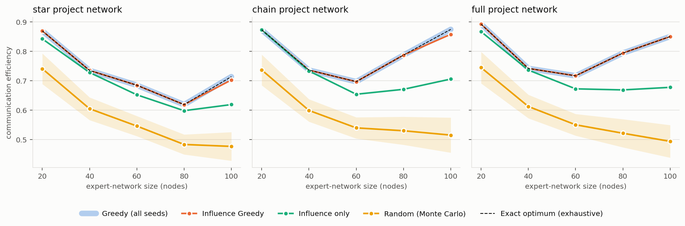

# Coordinator Selection in Expert Collaboration Networks

When several teams work on one project (say database, theory, AI and data-mining
groups), each team needs a **coordinator**. The coordinator should be central within
their own team, and should be well connected to the other teams' coordinators. This
repository builds a labelled collaboration network of **2,283 researchers from 1.6M DBLP
papers** and compares algorithms that choose one coordinator per team to maximise
communication efficiency.

**Main result:** across 15 settings (5 network sizes × 3 project topologies), greedy
selection **always finds the exact optimum**. That was checked by exhaustively searching
up to 390,625 candidate coordinator sets per setting. Greedy beats random coordinators
by **+17% to +72%**, and the gap grows with network size.



## Problem

* **Expert network** `G = (V, E, w)`: nodes are researchers, each labelled with one team
  (DB, T = theory, AI, DM). Edge weights are distances, so a lower weight means a
  stronger tie.
* **Project network** `P`: says which teams must talk to each other. There are three
  topologies:
  * `star`: Theory is the hub.
  * `chain`: DM–AI–T–DB.
  * `full`: every team talks to every other team.

  Cross-team edges between teams that are not linked in `P` are removed.
* **Objective:** choose `S` with exactly one coordinator per team to maximise

  ```
  comm_eff(S) = mean_{c in S} closeness_in_team(c)  +  α · mean_{c≠c' in S} hops(c,c') / dist(c,c')
  ```

  * The first term rewards coordinators who are central within their own team.
  * The second term rewards coordinators linked by short paths of strong ties.
  * `α = 2`.

## Data pipeline

1. **Papers:** 16.7K papers from 19 top venues (2000–2010), taken from the
   AMiner/DBLP citation dump: VLDB, SIGMOD, ICDE, PODS, ICML, COLT, UAI, STOC, FOCS,
   SODA, KDD, ICDM, WWW and others.
2. **Authors:** those with at least 5 papers. Each author's team is the area of the
   venue they publish in most.
3. **Edges:**
   * Co-authorship (at least 2 joint papers): Jaccard-style distance
     `1 − shared/(papers_u + papers_v)`.
   * Co-venue: both authors published at the same venue in the same year.

   Weights are min-max scaled to [1, 100], and the largest connected component is kept.
   The result has **2,283 nodes, 324K edges** (DB 808 · DM 552 · T 534 · AI 389).
4. **Team networks:** for each `k ∈ {5,…,25}`, a tightly knit `k`-member team is chosen
   from each area. The seed is the member with the highest closeness centrality; the
   team then grows by greedy minimum distance-sum. This gives 20- to 100-node networks.

## Algorithms

| Method | Idea | Cost |
|---|---|---|
| **Greedy** | From each seed, add the cross-team coordinator with the largest objective value; keep the best seed | O(n² · teams) evaluations |
| **Influence Greedy** | Greedy seeded only from each team's most central member | 4 greedy runs |
| **Influence only** | Each team's most central member; ignores cross-team ties | O(n) |
| **Random** | Monte Carlo mean over 1,000 random coordinator sets | baseline |
| **Exhaustive** | Exact optimum over all ∏ \|team\| combinations (vectorised NumPy) | O(kᵗᵉᵃᵐˢ) |

All pairwise shortest-path quantities are computed once. After that, scoring a
candidate set is a table lookup, which is what makes the exhaustive check cheap enough
to run on every instance.

## Results

Generated by `scripts/run_experiments.py` (`results/results.csv`):

|   Nodes | Project net   | Combinations   |   Optimum |   Greedy |   Influence Greedy |   Influence only |   Random (mean) | Greedy vs random   |
|--------:|:--------------|:---------------|----------:|---------:|-------------------:|-----------------:|----------------:|:-------------------|
|      20 | star          | 625            |    0.8698 |   0.8698 |             0.8698 |           0.8428 |          0.7412 | +17.3%             |
|      40 | star          | 10,000         |    0.7354 |   0.7354 |             0.7354 |           0.7284 |          0.6054 | +21.5%             |
|      60 | star          | 50,625         |    0.6852 |   0.6852 |             0.6852 |           0.6527 |          0.5465 | +25.4%             |
|      80 | star          | 160,000        |    0.6193 |   0.6193 |             0.6193 |           0.5986 |          0.4839 | +28.0%             |
|     100 | star          | 390,625        |    0.7142 |   0.7142 |             0.7031 |           0.6195 |          0.4773 | +49.6%             |
|      20 | chain         | 625            |    0.8734 |   0.8734 |             0.8734 |           0.8734 |          0.7371 | +18.5%             |
|      40 | chain         | 10,000         |    0.7365 |   0.7365 |             0.7365 |           0.7336 |          0.5995 | +22.9%             |
|      60 | chain         | 50,625         |    0.6973 |   0.6973 |             0.6973 |           0.6545 |          0.5402 | +29.1%             |
|      80 | chain         | 160,000        |    0.7876 |   0.7876 |             0.7876 |           0.6713 |          0.5305 | +48.5%             |
|     100 | chain         | 390,625        |    0.8749 |   0.8749 |             0.8583 |           0.7062 |          0.5157 | +69.7%             |
|      20 | full          | 625            |    0.8928 |   0.8928 |             0.8928 |           0.8673 |          0.7451 | +19.8%             |
|      40 | full          | 10,000         |    0.7423 |   0.7423 |             0.7423 |           0.7367 |          0.6129 | +21.1%             |
|      60 | full          | 50,625         |    0.7173 |   0.7173 |             0.7173 |           0.6729 |          0.5508 | +30.2%             |
|      80 | full          | 160,000        |    0.7945 |   0.7945 |             0.7945 |           0.6693 |          0.5221 | +52.2%             |
|     100 | full          | 390,625        |    0.8506 |   0.8506 |             0.8506 |           0.678  |          0.4944 | +72.0%             |

* **Greedy is optimal in all 15 settings.**
* **Influence Greedy is optimal in 13 of 15** and within 1.9% otherwise.
* **Influence only** falls far behind as networks grow, losing up to 20% at 100 nodes.
  The most central person in each team is not necessarily the best-connected person
  across teams.
* **Random coordinators get worse as networks grow, but the optimum doesn't.** With
  more candidates, a well-connected cross-team set exists, but a random pick is less
  likely to find it.
* Selected coordinators are well-known researchers, which is a useful sanity check. For
  example, the 60-node full network picks Philip S. Yu (DM), Hamid Pirahesh (DB),
  Tim Roughgarden (T) and Satinder P. Singh (AI); see `results/selected_coordinators.json`.

## Reproduce

```bash
pip install -r requirements.txt

# Option A: run the experiments on the included team networks (seconds)
python scripts/run_experiments.py && python scripts/make_figures.py

# Option B: rebuild everything from raw DBLP (about 20 min)
#   Download the AMiner DBLP citation dataset (text format with #* #@ #t #c #index
#   records, 1,632,442 papers) from https://www.aminer.cn/citation and save it as
#   data/raw/dblp.txt
python scripts/build_network.py
python scripts/run_experiments.py && python scripts/make_figures.py

pytest -q   # unit tests: objective, greedy vs. exhaustive, project networks, pipeline
```

## Repository layout

```
src/coordsel/
  data.py        DBLP parsing, author records, weighted expert network, team labels
  networks.py    k-member team networks, project-network topologies
  objective.py   communication-efficiency objective (pre-computed pairwise tables)
  algorithms.py  greedy, influence greedy, influence only, random, exhaustive
scripts/         build_network.py, run_experiments.py, make_figures.py
data/networks/   the five team networks (GraphML), so experiments run without raw DBLP
results/         results.csv, results_table.md, selected_coordinators.json, figures/
tests/
```

## Limitations and next steps

* **Exhaustive search is still feasible here.** With 4 teams of at most 25 people,
  exhaustive search takes under 0.1 s. Greedy's advantage is scaling: exhaustive cost
  grows as `kᵗ` with the number of teams `t`, while greedy grows polynomially. A natural
  extension is more teams, using finer-grained venue areas.
* **Co-venue weighting.** Repeated co-venue participation *adds* to the distance
  weight, so it slightly weakens a tie rather than strengthening it. This mirrors the
  original experiment and is kept for reproducibility. An inverse-weight variant is
  worth testing.
* **Next:** compare against classic team-formation baselines such as Lappas et al., KDD
  2009 (RarestFirst / EnhancedSteiner).
